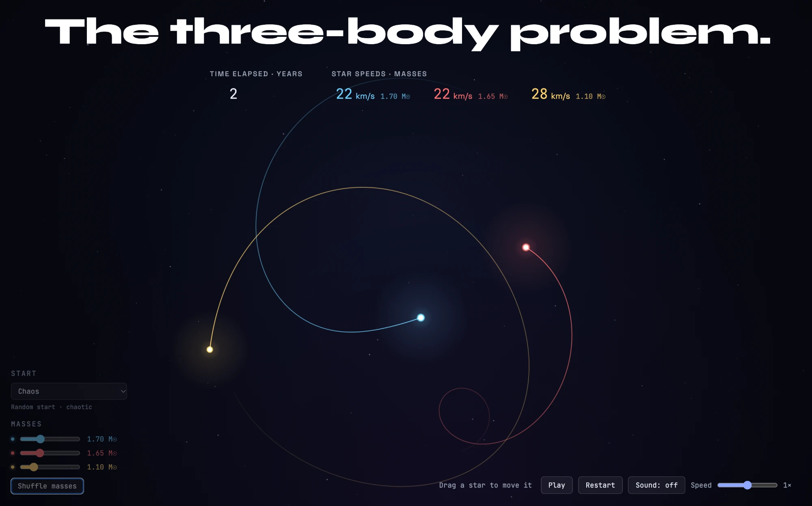

# The three-body problem

An interactive simulation of three stars pulling on each other with gravity — and of how quickly that turns into chaos.

**▶ Live demo: [edbond88.github.io/gravity-3](https://edbond88.github.io/gravity-3/)**

[](https://edbond88.github.io/gravity-3/)

## Features

- **Real physics** — Newtonian gravity in AU, years and solar masses, integrated with velocity Verlet and an adaptive time step that shrinks during close encounters.
- **Adjustable masses** — set each star's mass from 0.2 to 5 M☉, or shuffle them. The current speed and mass of every star are shown at the top.
- **Known solutions** — besides random chaotic starts, pick a famous configuration:
  - classical: Lagrange's equilateral triangle and Euler's collinear solution;
  - periodic orbits: the figure-eight (Moore, Chenciner & Montgomery) and the butterfly, moth, goggles, dragonfly and yin-yang orbits (Šuvakov & Dmitrašinović, 2013);
  - a stable hierarchical triple: a tight binary with a distant third star.

  Most of them are unstable, so they hold their shape for a few periods and then fall apart into chaos.
- **Gravity field** — show the potential the stars move in, as a rubber sheet pulled into wells or as a heat map with isolines. Points where the stars' pulls cancel out are marked.
- **Energy** — colour the trails by energy to see whether each star is bound, at escape speed or already escaping. The energy drift |ΔE/E₀| at the top shows how accurately the integrator conserves energy.
- **Drag stars** — grab any star. Paused, move it somewhere else; running, hold it while the others orbit around it, and throw it — when let go it keeps the speed you gave it. The centre of mass is recomputed.
- **Sound and light** — close encounters thump, panned to where they happen, and flash with a spray of sparks.
- **Living sky** — trails glow and turn white-hot where a star moves fast; stars twinkle, show diffraction spikes and are tinted by mass (light ones orange, heavy ones blue-white); the nebula and three layers of background stars shift at different depths as the camera zooms. Animation is toned down when the system asks for reduced motion.
- **Auto-restart** — when a star escapes, a new system starts.
- **Built-in help** — press **?** for a short guide and the list of shortcuts.
- **English and Ukrainian** — switch the language in the top-right corner. The choice is remembered; on the first visit it follows the browser's language.

## Controls

| Key | Action |
|---|---|
| Space | Pause / play |
| R | Restart |
| N | Shuffle masses |
| M | Sound on / off |
| G | Gravity field: off / rubber sheet / heat map |
| T | Trails on / off |
| F | Flashes on / off |
| E | Trail colour: speed / energy |
| U | Hide / show the controls |
| + / − | Faster / slower time |
| 1 … 9, 0 | Choose a starting configuration |
| ? / H | Show / hide help |
| Esc | Close help |

Drag a star with the mouse (or a finger) to move it — paused or running. Released while running, it flies off at the speed it was thrown.

## Running locally

No build step — it's plain HTML, CSS and JavaScript. Serve the folder with any static server:

```bash
python3 -m http.server 8173
```

Then open <http://localhost:8173>.

## Project structure

| File | What's inside |
|---|---|
| `index.html` | Page layout, controls and the help dialog |
| `js/physics.js` | Gravity, energies, the Verlet integrator and its adaptive step — pure functions, no DOM |
| `js/presets.js` | Starting configurations: random chaos, Lagrange, Euler, figure-eight, Šuvakov orbits, hierarchical triple |
| `js/simulation.js` | Simulation state, advancing it in time, trails, close encounters, restarts |
| `js/camera.js` | Canvas setup and the camera that keeps every star in view |
| `js/background.js` | Nebula and parallax star field |
| `js/field.js` | Gravity field overlay: rubber sheet, heat map, equilibrium points |
| `js/render.js` | Trails, stars and close-encounter bursts |
| `js/hud.js` | Time, energy drift, speeds and masses at the top |
| `js/controls.js` | Buttons, sliders, keyboard shortcuts and dragging stars |
| `js/main.js` | The animation loop and start-up |
| `js/audio.js` | Sound effects for close encounters |
| `js/i18n.js` | English and Ukrainian strings and the language switcher |
| `style.css` | Styles |
| `tests/` | Tests for the physics, the starting configurations and the translations |

The scripts are plain `<script>` tags sharing globals, loaded in the order listed in `index.html`.

## Tests

The tests use Node's built-in test runner (Node 20 or newer), with no dependencies:

```bash
npm test
```

They load `js/physics.js`, `js/presets.js` and `js/i18n.js` the way the browser does and check that the integrator conserves energy, momentum and angular momentum and is time-reversible, that every periodic orbit comes back after one period, that the Lagrange and Euler solutions rotate rigidly, and that no translation is missing.
